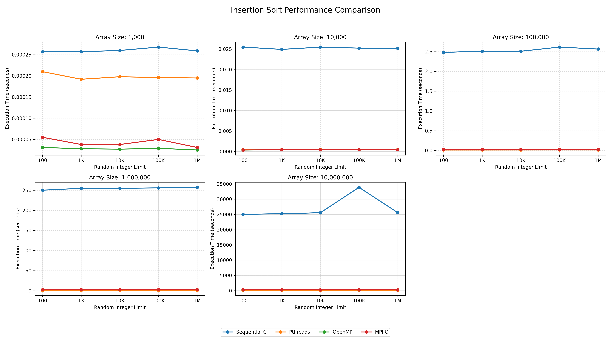

# Parallel Insertion Sort Comparison

## Overview

This project studies how insertion sort can be adapted to different parallel programming methodologies. A direct sequential implementation is compared with POSIX threads (pthreads), OpenMP, and MPI implementations written in C.

Insertion sort is naturally sequential because each iteration depends on the sorted prefix produced by earlier iterations. To enable parallel execution, the input array is divided into nearly equal chunks. Each worker sorts one chunk using insertion sort, and the sorted chunks are merged to produce the final result.

The project compares the implementations in terms of correctness, execution time, speedup, scalability, parallel overhead, implementation complexity, and code quality.

## Implemented Methods

### Sequential C

The sequential version creates a copy of the input and applies standard insertion sort to the complete array using one CPU.

### POSIX Threads

The pthreads version divides the array into chunks, creates one thread for each chunk, waits for the threads using `pthread_join()`, and merges the sorted results. Thread creation and synchronization are managed manually.

### OpenMP

The OpenMP version uses the same chunk-sort-merge design, but parallelizes the chunk-sorting loop using:

```c
#pragma omp parallel for num_threads(workerCount)
```

OpenMP reduces the amount of manual thread-management code while still using shared memory.

### MPI

The MPI version uses separate processes. Rank 0 calculates the chunk sizes, `MPI_Scatterv()` distributes the input, every process sorts its local chunk, and `MPI_Gatherv()` returns the sorted chunks to rank 0 for merging.

## Parallel Design

All parallel implementations follow the same general process:

1. Divide the input into nearly equal chunks.
2. Assign one chunk to each worker.
3. Sort every chunk using sequential insertion sort.
4. Wait for all workers to finish.
5. Merge pairs of sorted chunks until one array remains.
6. Verify that the final array is correctly sorted.

The design demonstrates the Manager-Worker, Fork-Join, MapReduce, and Scatter-Gather patterns. Scatter-Gather is specifically used by the MPI implementation.

## Test Data

The benchmark evaluates all combinations of the following array sizes:

```text
1,000
10,000
100,000
1,000,000
10,000,000
```

and random integer limits:

```text
100
1,000
10,000
100,000
1,000,000
```

A fixed random seed of 42 is used to make the generated inputs repeatable. A separate demonstration program prints every insertion-sort step for a sample of 10 integers.

## Correctness

After each benchmark, `isSorted()` verifies that every value is less than or equal to the value following it. The correctness check is performed after timing so that it does not affect the reported sorting time.

## Complexity

Direct sequential insertion sort has a best-case time complexity of `O(n)` and an average and worst-case complexity of `O(n²)`.

With `p` chunks, each worker sorts approximately `n/p` elements. The combined insertion-sort work is approximately `O(n²/p)`, while pairwise merging requires `O(n log p)` work. Consequently, the measured speedup includes both concurrent execution and the reduction in sorting work produced by partitioning.

## Repository Contents

| File | Description |
|---|---|
| `methods/sequential_sort.C` | Sequential insertion-sort benchmark |
| `methods/multithreading.c` | POSIX pthreads implementation |
| `methods/openMP.c` | OpenMP implementation |
| `methods/mpi.c` | MPI implementation |
| `methods/demo.c` | Small insertion-sort demonstration with step output |
| `run_test.sh` | Slurm batch script for running the benchmarks |
| `results/*.csv` | Recorded benchmark results |
| `all_methods_comparison.png` | Performance-comparison graph |

## Requirements

- GCC
- POSIX threads
- OpenMP
- OpenMPI or another MPI implementation
- Slurm, when running on the HPC cluster

## Compilation and Local Execution

### Sequential

The uppercase `.C` extension may be interpreted as C++, so `-x c` explicitly selects C:

```bash
gcc -x c -O2 methods/sequential_sort.C -o sequential_sort
./sequential_sort
```

### Pthreads

```bash
gcc -O2 -pthread methods/multithreading.c -o multithreading
./multithreading
```

### OpenMP

```bash
gcc -O2 -fopenmp methods/openMP.c -o openMP
export OMP_NUM_THREADS=10
./openMP
```

### MPI

```bash
mpicc -O2 methods/mpi.c -o mpi
mpirun -np 10 ./mpi
```

## HPC Configuration

All methods are run on one compute node. The worker count can be adjusted in the Slurm script.

| Method | Tasks | CPUs per task | Execution model |
|---|---:|---:|---|
| Sequential | 1 | 1 | One process |
| Pthreads | 1 | Worker count | Shared-memory threads |
| OpenMP | 1 | Worker count | Shared-memory threads |
| MPI | Worker count | 1 | Independent MPI processes |

Submit the included Slurm script using:

```bash
sbatch run_test.sh
```

Monitor the jobs using:

```bash
squeue -u "$USER"
```

## Results

The sequential implementation becomes increasingly expensive as the input grows because of insertion sort's quadratic behavior. Parallel overhead can make pthreads or OpenMP slower for very small arrays, but the parallel methods become substantially faster for larger inputs.

Pthreads and OpenMP generally produce similar large-input performance because both use shared-memory threads and the same chunk-sort-merge design. OpenMP requires less thread-management code, while pthreads provides more explicit control. MPI introduces additional communication and implementation complexity but produced the fastest large-input results in the recorded experiments.

The random integer limit has a relatively small effect compared with the array size. Lower limits create more duplicate values, but the overall performance trend remains similar across the tested limits.

## Performance Graphs

### Comparison of All Methods

The following graph compares the execution times of Sequential C, pthreads, OpenMP, and MPI across the tested array sizes and random integer limits.



The raw measurements used for the comparison are stored in the `results` directory.

## Speedup Interpretation

Speedup is calculated using:

```text
speedup = sequential time / parallel time
```

The reported values are total observed speedups. They should not be interpreted as pure parallel efficiency because the direct sequential implementation and the chunked parallel implementations do not perform exactly the same amount of sorting work. A sequential chunked control would be required to isolate the benefit caused only by concurrent execution and to make a direct experimental comparison with Amdahl's law.

## Authors

- Raghad Elajab — 100064670
- Fatema Hallalo — 100064900
- Mouza Alshehhi — 100063163

Khalifa University — COSC 410 Parallel and Distributed Computing, Fall 2026
